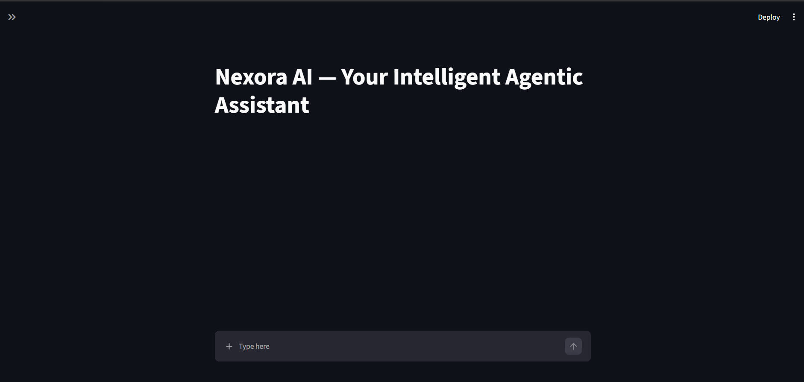
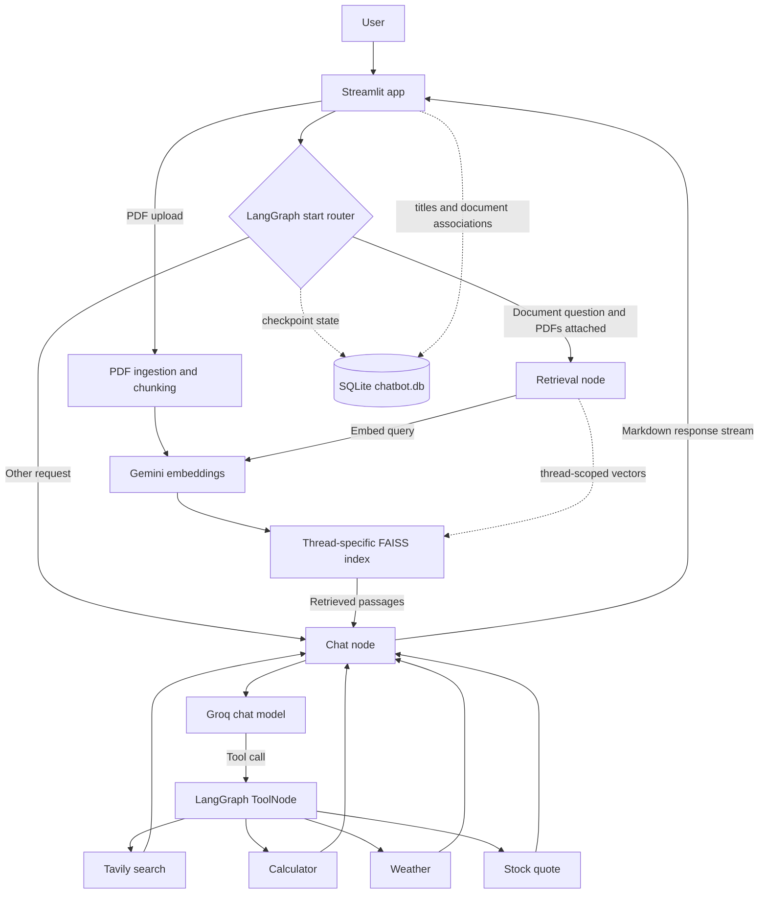

# Nexora AI — Your Intelligent Agentic Assistant

**Think. Retrieve. Act.**

[](https://www.python.org/)
[](https://streamlit.io/)
[](https://www.langchain.com/langgraph)
[](https://github.com/facebookresearch/faiss)

> A portfolio project demonstrating a stateful, tool-using assistant with conversation-scoped PDF retrieval.



## Project Overview

Nexora AI is a Python assistant with a Streamlit chat interface and a LangGraph workflow. It uses Groq for chat completions, can call web and utility tools, and retrieves relevant passages from PDFs attached to the active conversation. SQLite persists graph checkpoints and conversation metadata; FAISS stores each conversation’s document vectors.

## Features

- Stream assistant responses token by token and display tool activity.
- Create chats and reopen persisted conversations with sidebar titles.
- Upload PDFs in chat and ask questions grounded in retrieved passages.
- Keep document associations and FAISS indexes scoped to their conversation.
- Route requests through a LangGraph graph with conditional retrieval and tool execution.
- Use Tavily search, a safe arithmetic calculator, current weather, and stock quotes.
- Render assistant answers as Markdown in Streamlit.

## Application Screenshots

### Main chat interface

The clean landing state of the Streamlit chat UI:


The other local gallery images contain personal chat content, profile details, conversation titles, or account-level observability information. They are intentionally not included in this public-facing gallery.

## Technology Stack

| Area | Technologies |
| --- | --- |
| Language and UI | Python 3.13, Streamlit |
| Agent orchestration | LangGraph, LangChain |
| Chat model | Groq (`openai/gpt-oss-20b`) |
| Embeddings | Google Gemini (`gemini-embedding-001`) |
| Vector search | FAISS |
| Persistence | SQLite, LangGraph `SqliteSaver` |
| PDF processing | PyPDF, RecursiveCharacterTextSplitter |
| External tools | Tavily Search, OpenWeather, Alpha Vantage |

## System Architecture



## How It Works

1. Streamlit passes the active conversation ID to the compiled LangGraph application.
2. The start router checks the latest user request and whether that conversation has attached documents. Likely document questions go through retrieval; other requests go directly to the chat node.
3. The retrieval node searches the active thread’s FAISS index and passes the retrieved passages to the chat node as context.
4. The Groq model responds or requests an available tool. LangGraph’s `ToolNode` executes tool calls and loops the result back to the chat node.
5. LangGraph checkpoints, conversation titles, and document associations are persisted in SQLite. Assistant text is streamed to Streamlit and rendered as Markdown.

## Project Structure

```text
app.py                       Streamlit entry point
frontend/
  sidebar.py                 Conversation navigation and history loading
  chat_ui.py                 Chat rendering and streamed responses
  file_upload.py             PDF uploads and attached-document list
backend/
  config.py                  Project paths and .env loading
  llm.py                     Groq and Gemini clients
  memory.py                  SQLite connections and graph checkpointer
  conversations.py           Conversation titles and document associations
  state.py                   Graph state and retrieval routing
  nodes.py                   Chat and retrieval nodes
  graph.py                   Graph construction and compilation
  rag/
    ingestion.py             PDF loading, chunking, and per-thread FAISS
    retrieval.py             PDF retrieval tool
  tools/                      Search, calculator, weather, and stock tools
nexora_backend.py            Compatibility exports
tests/
  test_backend_components.py Focused API-free tests
assets/
  screenshots/                Curated public screenshots
```

## Installation and Setup

Use Python 3.13 and run these commands from the project root in PowerShell:

```powershell
py -3.13 -m venv .venv
.\.venv\Scripts\Activate.ps1
python -m pip install --upgrade pip
python -m pip install -r requirements.txt
Copy-Item .env.example .env
```

Edit `.env` and add the credentials for the services you plan to use. Never commit real credentials.

## Environment Variables

| Variable | Required for |
| --- | --- |
| `GROQ_API_KEY` | Groq chat completions |
| `GOOGLE_API_KEY` | Gemini embeddings for PDF ingestion and retrieval |
| `TAVILY_API_KEY` | Tavily web search |
| `OPENWEATHER_API_KEY` | Current weather tool |
| `ALPHAVANTAGE_API_KEY` | Stock quote tool |

The Groq and Google keys are needed for normal chat and PDF embedding operations. The tool-specific keys are needed only when using their corresponding services. `.env.example` contains blank placeholders only.

## Running the Application

From the activated environment and project root:

```powershell
streamlit run app.py
```

Streamlit prints the local URL after startup. Focused offline tests can be run with:

```powershell
python -m unittest discover -s tests -v
```

## Agentic Tool Integration

The chat model is bound to the existing Tavily search, calculator, weather, and stock tools. When the model requests a tool call, `ToolNode` executes it and returns its result to the chat node for a final response. The RAG tool is also registered in the graph’s tool node, while normal document routing invokes retrieval through the dedicated retrieval node before calling the model.

## RAG and Document Retrieval

Uploaded PDFs are loaded with PyPDF and split into chunks of 1,000 characters with 200 characters of overlap. Chunks are embedded with `gemini-embedding-001` and stored in a FAISS index. Retrieval returns up to four relevant chunks with filename and page metadata. The system prompt instructs the model to ground PDF answers in the supplied context and not follow instructions found in document text.

## Conversation Memory and PDF Isolation

The existing `chatbot.db` stores LangGraph checkpoints and the `conversation_titles` and `conversation_documents` metadata tables. Checkpoints use the existing thread IDs. FAISS files are stored under `faiss_db/threads/<sha256-of-thread-id>/`; retrieval first resolves the documents associated with the active thread and filters results to those document IDs. A chat without associated PDFs cannot retrieve another chat’s documents.

Local databases, FAISS indexes, PDFs, `.env`, and generated files are excluded by `.gitignore`. Keep a backup of private conversation data separately; it is not part of this source repository.

## Future Improvements

Potential next steps (not implemented features) include adding automated integration tests with mocked provider clients, evaluating retrieval quality on a maintained test set, and adding deployment and operational guidance for a hosted environment.

## Author

**Kapil Dev Chaudhary**

---

*Nexora AI — Think. Retrieve. Act.*
